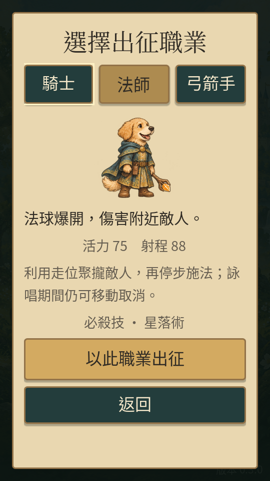
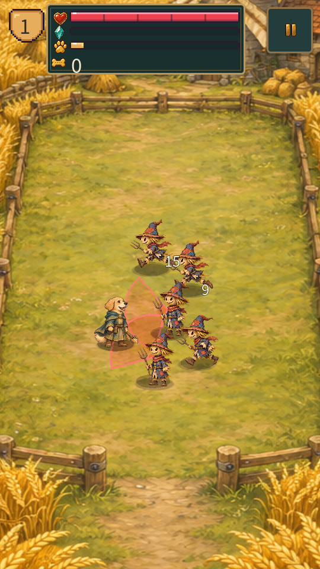
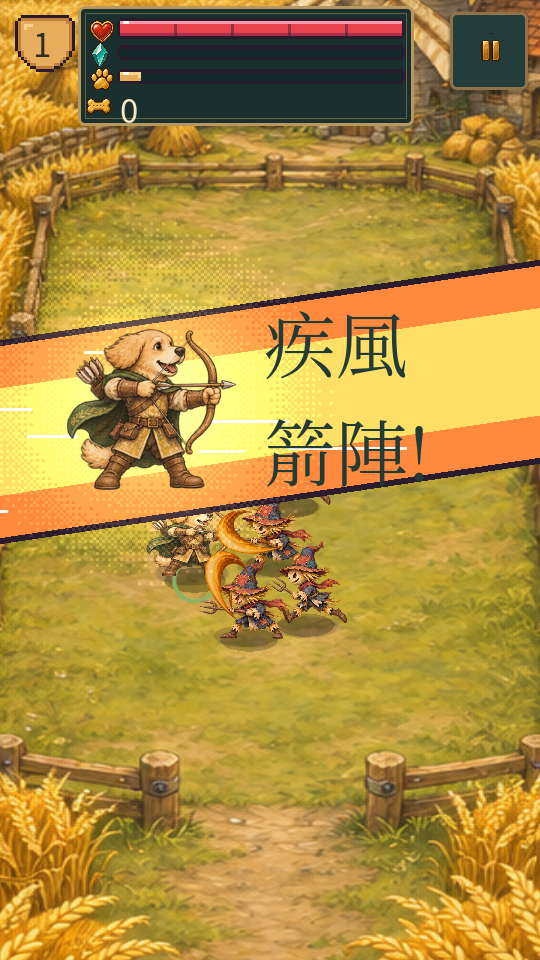

# [INT] Add playable classes, adaptive music and refined typography

Players can now choose knight, mage or archer before a story run or endless trial. All three classes are available immediately. Mage orbs travel and explode on impact; archer arrows pierce enemies and gain focus damage after standing still. Each class has its own ultimate, illustrated poses and starting statistics. Saves preserve the story class across continue/retry and remain compatible with older versions.

Replace short repetitive background loops with 15 original, longer sectioned tracks and 12 matching battle-pressure layers. Enemy density, remaining vigor and boss phases control accompaniment intensity. Refresh Chinese title/body typography, damage labels and compact portrait class-selection layout.

This draft targets `codex/storybook-art-overhaul` (PR #10), which itself follows the Windows playtest PR #9. No new executable or game package is included.

Validation:

- Full Godot 4.7.2 regression rerun immediately before this PR: 802 tests passed, zero failed assertions or broken files; runner exit code 0. Both original and publication logs are retained in `docs/validation/0.3.0/`.
- Earlier continuation check: 14 class/combat/save tests passed. No gameplay code changed during recovery or publication.
- Existing normal-damage bot runs: all three classes completed chapter 1; mage and archer completed chapter 6, totaling 30 successful level completions. Fixed seed 7 and class-specific bots do not establish balance.
- 27 OGG files decoded successfully, no clipping, and each of 12 accompaniment loops matches its main track length.
- Existing Linux OpenGL captures cover 32 screens, including small-window class selection. Included gameplay illustrations use staged capture scenarios; they are separate from the normal-damage bot tests.

Limitations: existing test teardown/resource cleanup errors and exit warnings remain. No native Windows/mobile playtest, manual listening review, or new executable export. The current continuation environment could not start Xvfb, so supplied renders are the previously verified captures of the unchanged game implementation.

Implementation and evidence: `docs/MUSIC_CLASSES_TYPOGRAPHY.md`, `docs/validation/0.3.0/`, and `docs/CONTINUATION_20261119.md`.

The published implementation tree `7d4dc6108ac044e28513d59b2cc234cc352b2ec4` exactly matches the recovered local snapshot, including all 137 changed files. Publication follow-up changes only documentation and validation records.

Screenshots below are actual Linux Godot renders of this implementation, captured with staged scenarios. They are visual evidence, not normal-damage playthrough evidence.

| Class selection | Mage combat | Archer ultimate |
| --- | --- | --- |
|  |  |  |
