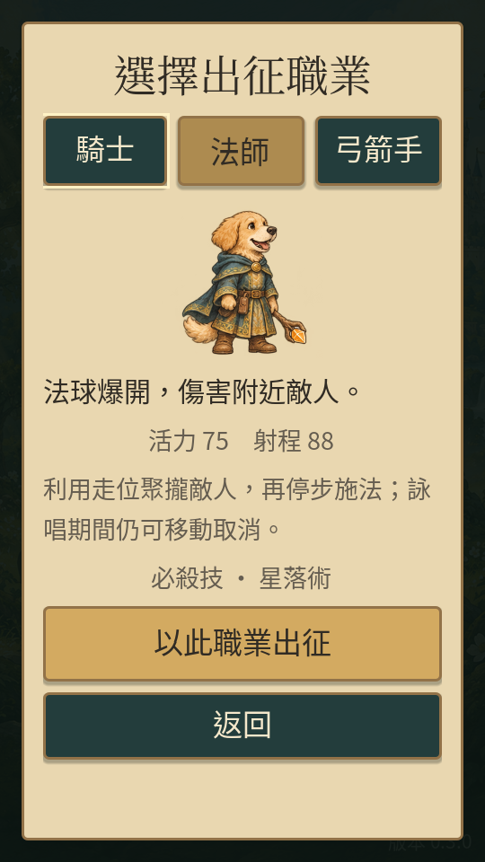
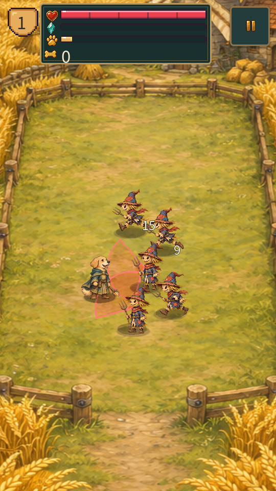
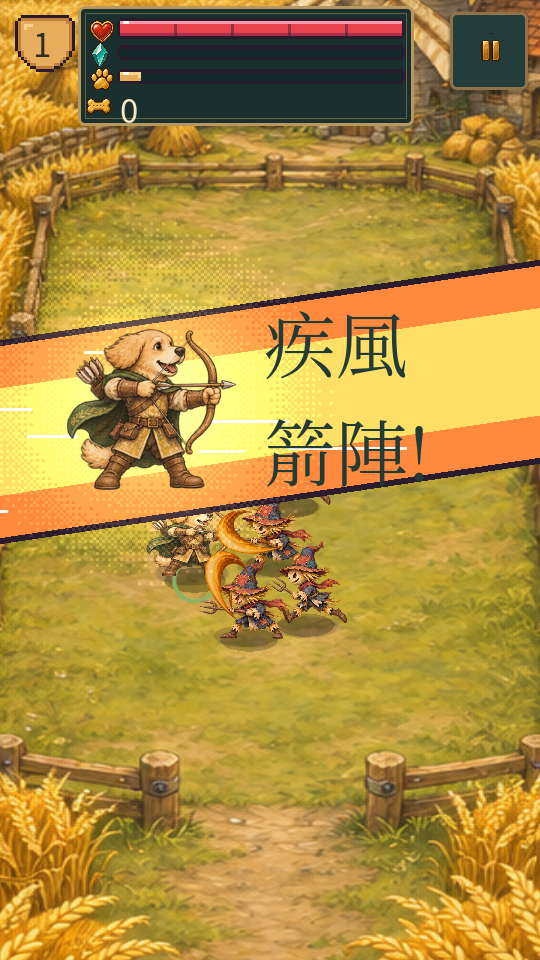

# 0.3.0 驗證紀錄

日期：2026-11-19。Godot `4.7.2.stable.official.ed1daf0bf`。

- `test_suite.log`：完整 802 項測試，0 assertion failures、0 broken test files；不是無警告日誌。既有測試在銷毀訊號來源後仍嘗試斷線，以及故事流程測試的 Lambda 捕捉已釋放物件，會印出測試清理錯誤；退出亦有未釋放資源警告。沒有把這些訊息從日誌刪除。
- `bot_*.log`、`playthrough_summary.json`：正式關卡試玩，共 5 次、30 次成功關卡完成，騎士另重試 3 次。只選種子 7，不能代表職業平衡、平均勝率或真人體驗。
- `audio_checks.json`：FFmpeg 解碼全部 27 個 OGG 為 32 kHz stereo float PCM，全部有限數值、無削波，峰值最大 0.46122；12 組伴奏與主音軌等長。這是檔案與訊號檢查，不是主觀聆聽。
- `render_manifest.json`：Linux Xvfb + Mesa llvmpipe 真實 OpenGL 渲染 32 張畫面的尺寸和 SHA-256，含選角、三職業戰鬥與切入、360×640 小視窗、六章、頭目、營地、故事、升級及小遊戲。精選五張 PNG 隨此紀錄保留。

```bash
GODOT=/path/to/Godot_v4.7.2-stable_linux.x86_64 TEST_TIMEOUT=900 tools/run_tests.sh
/path/to/godot --headless --path . res://tests/integration/playthrough_bot.tscn -- --class=mage --chapter=6 --seed=7 --speed=4
ART_CAPTURE_DIR=/tmp/classes /path/to/godot --path . --audio-driver Dummy --rendering-driver opengl3 --script res://tools/capture_classes.gd
```

完整測試由 runner 建立獨立 user://。機器人亦各用獨立 XDG_DATA_HOME，不接觸玩家存檔。未進行 Windows／手機實機試玩、耳機人工聆聽或新版執行檔匯出。

對照修改前的 `4dbd678344db9999b1cbebafdfc0dd11953c18a6`，以同一 Godot 執行 `story_flow`（11 項）及 `test_events`（7 項）：全部斷言通過，但同樣重現 Lambda 捕捉已釋放物件、`is_connected` 的 null object 和退出資源警告。對照日誌為 `baseline_story_flow.log`、`baseline_events.log`；本輪沒有修改這兩個測試或測試框架，也沒有宣稱已修復其清理問題。

## 實際遊戲截圖

以下均由本分支的 Godot 遊戲畫面直接擷取。

選擇職業：



法師戰鬥（主目標與範圍傷害）：



弓箭手必殺技切入：


