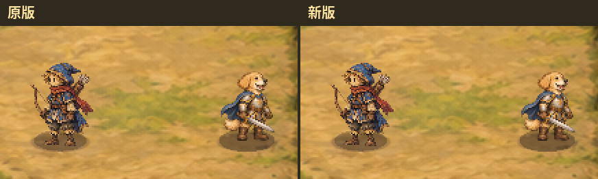

# 弓兵何時鎖定，何時放箭

藍兜帽稻草人現在會舉弓追著金毛轉；地上的射線鎖定時，才把弦拉到臉側。箭離手那一幀，手和弓上就只剩空弦，接著才收弓。朝左、右、鏡頭前和鏡頭後都能看到這個動作。



兩邊都是第一章農場的 Godot 實拍，使用同一個鏡頭及連續 100 個物理幀。取景為畫面內 217×112 像素，各放大兩倍並排，以正常速度循環一次約 1.67 秒。完整 360×640 原圖可以看出弓兵在遊戲中的實際大小。[滿弓鎖線](field-locked.png) · [弓弦放開當幀](field-release.png) · [鎖定後金毛側移](field-sidestep.png)

## 十二幅動作

舊版在追蹤和鎖定時都顯示垂弓，箭已經飛出時才畫滿弓搭箭。GPT Image 沿用現有敵方弓兵的藍兜帽、紅領巾、箭筒與木弓。側面面朝右，朝左時只翻轉側面；角色正向或背向鏡頭時，輕微左右追蹤仍用同一隻手搭箭。每個方向各畫半拉弓、滿弓、放手與收弓。

第一張原稿的側面保留。它的正面與背面卻把箭畫成側射，第二張原稿改用迎面縮短的箭頭與背面由肩膀遮住的弓臂。十二格以同排共同縮放比例和雙腳位置對齊。在 alpha ≥32/255 下，各格最低的墨色像素位置相差最多兩像素，距格邊最少五像素。遊戲圖集 SHA-256 為 `a275fd5ed93df6aca6a8027e64cb35e68e8845bc88554c563bdf6c55a875f2f3`。[第一稿](first-sheet.png) · [重畫的正背面](vertical-sheet.png) · [遊戲圖集](../../../assets/illustrated/motion/archer_draw.png) · [完整提示、來源指紋與對位](art.json)

## 六場固定比較

基準為 [草稿 #28](https://github.com/QuantumPrediction/DoggyKnight/pull/28) 的 `f082bb3de6c919dd5ce2f894f7350d7d2bc7b791`，tree `84b2bca071b0b5959af213049cf43be95059d4b2`。兩版都用正式農場場地、騎士、普通難度及同一個擺位程式，種子 19028。第 3 幀讓原有射擊冷卻完成。測試控制金毛的位置與中止場景的暈眩，箭矢由正式弓兵產生、飛行與碰撞。這六場沒有玩家操作。[事先登記的比較門檻](../../requests/20261123-INT-archer-draw-motion.md)

| 固定遭遇 | 實際發生的事（60 Hz） | 結果 |
| --- | --- | --- |
| 朝右、左、前、後，金毛站定 | 第 3 幀半拉弓追蹤，22 鎖定滿弓，38 射線閃爍，45 放箭，51 收弓 | 四次各射一箭，均在第 75 幀命中，活力 100 → 91 |
| 追蹤時轉向，鎖定後側移 | 第 10 幀金毛由弓兵下方移向右方，第 22 幀鎖線，第 31 幀移出射線 | 第 45 幀的箭仍沿原有射線射出，未命中，活力 100 |
| 鎖定後打斷 | 第 22 幀鎖定，第 31 幀弓兵被暈眩 | 地面射線消失，零發射，活力 100 |

兩版各六場、每場 100 幀。基準、斜向修正前候選、最終候選三次 headless 執行及四次原生執行記下相同的 600 列資料，SHA-256 為 `1cc05cac8d534d919603a164125a793b9da5071aba07deeb32999fac7b0970e4`。內容包括雙方位置、弓兵朝向、瞄準、預警幾何與進度、射箭計數、箭的出發點與位置、命中和活力。[逐幀紀錄](combat.tsv)

## 地面射線與剩餘遮擋

Linux X11／GL Compatibility 使用 Godot 4.7.2（`ed1daf0bf`）與 Mesa 25.0.7 llvmpipe。在 33 個相同時點各拍一對 360×640 畫面。四對控制的整張 RGB 相同，包括待機、恢復移動、金毛中箭及暈眩取消。其餘 29 對的差異全在原有弓兵繪圖框加一像素濾波邊內，兩版繪圖框相同。

在有地面預警的 19 個時點，每版再拍同一幀，只關閉那一次地面預警的繪製。任一 RGB 通道相差至少 8/255 才計為可見。數字是逐幀像素樣本，同一位置可在不同幀再被計算。

| 量度位置 | 新舊差異 |
| --- | --- |
| 沿射線距弓兵超過 24 個世界單位 | 舊版 30,756 個可見樣本全部保留 |
| 12 張已鎖線畫面的末端括號 | 區域內原可見的 2,112 個樣本全部保留 |
| 弓兵身邊與腳下 | 19 幀共遮住 811 個原可見樣本，另露出 1,510 個。向左滿弓的第 22 幀遮住最多，85 個消失、89 個露出 |

背向鏡頭時，兜帽和箭筒遮住拉弦手；放手首幀的實際飛箭又短暫蓋住軀幹。這個方向半拉弓與滿弓的差別仍細小。六本無損 WebP 保存所有 104 張來源畫面的完整 RGB，索引列出每張原 PNG 和解碼後 RGB 的 SHA-256。上方三張原圖另保留引擎直接寫出的 PNG。[影像索引](native/index.json) · [六組原生畫面](native/) · [各畫面的像素結果](native-checks.json)

## 重驗

在專案根目錄，`python tools/pack_archer_draw.py` 依原稿和已登記的對位重建圖集，需要 Pillow 和 ImageMagick。`python tools/check_archer_draw.py` 用 Pillow 和 NumPy 重讀留存畫面、核對來源圖與 RGB 指紋，再重算上表。

重拍時兩版使用相同的 `tests/integration/archer_draw_showcase.gd` 和同名場景。每次使用獨立的 `XDG_DATA_HOME` 和絕對路徑 `ARCHER_DRAW_DIR`，分別輸出至 `before/on`、`before/off`、`after/on`、`after/off`。`ARCHER_DRAW_NO_INK` 在 off 組設為 1，其餘為 0。`ARCHER_DRAW_FILM=1` 會保留向右射箭的 100 幀連續取景。先匯入兩版，再以同一執行檔執行。

```sh
godot --fixed-fps 60 --resolution 360x640 --display-driver x11 --rendering-method gl_compatibility --audio-driver Dummy res://tests/integration/archer_draw_showcase.tscn
python tools/check_archer_draw.py /absolute/path/to/captures
TEST_TIMEOUT=900 bash tools/run_tests.sh
```

引擎執行檔 SHA-256 為 `8d106cbe6144c2dc7e881d61d2429c1a8a76e6b22ef48bd5e48dcf934953f71e`。首次專項 3/4，失敗發生在正斜向的兩個分量經浮點運算後有細微偏差，導致錯選正面且沒有鏡像。修正繪圖方向後，專項 4/4，涵蓋左右手、鎖定後移動、實際放箭、下一次重新瞄準、暈眩、受傷、死亡與暫停後繼續。全套首次在預設 300 秒內完成 830 項後逾時。已保留該次輸出。[最初方向測試](diagonal-first-test.txt) · [首次全套逾時紀錄](first-timeout.log.gz)

採專案既有的 900 秒上限重跑完整測試，實際通過 **979/979**，0 failed、0 broken files，結束碼 0。同機基準 #28 亦通過 **975/975**。兩版退出時各列出 33 個 ObjectDB 物件、24 個資源及相同的 RID 警告。四次原生截圖執行均正常結束。歷史上的原生崩潰繼續另案追蹤。[候選完整輸出](candidate-tests.log.gz) · [同機基準完整輸出](baseline-tests.log.gz) · [原生崩潰紀錄](../field-chests/README.md)

[草稿 #29](https://github.com/QuantumPrediction/DoggyKnight/pull/29) 的受測公開提交為 `8ad38aa95469d922e62873330122e45b1061af9e`，與本地受測提交共用 tree `56a8c456fdfa294e07957f9b88fbfb0e107726b3`。

下一步用真手機以正常速度記錄幀時間，並在既有無提示試玩中記下實際看見敵方弓兵追蹤與鎖線的人數、第一個動作及首次看錯的時點，特別留意背向鏡頭的情況。目標玩家 0 人，手機、Windows、手把、聆聽及留存仍待驗證，整體暫評 6–6.5/10。[無提示試玩入口](../scene-lifetime/archer-trial.md)
