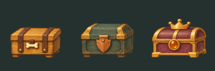
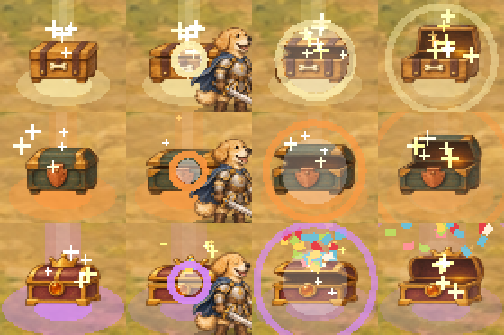

# 戰場上會出現哪一種寶箱？

左邊是行裝木箱。平蓋上繞了兩條皮帶，骨頭搭扣留給金毛打開。中間的精英箱有削角青綠外殼與銅盾扣。右邊的頭目箱有酒紅拱蓋、金冠和琥珀。上圖取自正式遊戲用的十二格插畫，循環方便看清動作。

## 在遊戲裡看

每列由左至右為合蓋、首次拾取、半開和全開。這十二個細節從 360×640 畫面原位裁切，再以最近鄰放大兩倍。下表可以打開完整原圖。場景使用第一章農場、正式拾取物和 HUD，騎士進入拾取範圍的時點由測試固定。

| 完整畫面 | 舊版 | 本輪 |
| --- | --- | --- |
| 三個寶箱同時落地 | [舊版全景](native/before/field.png) | [新版全景](native/after/field.png) |
| 普通箱首次拾取 | [舊版第 36 幀](native/before/ordinary-0.png) | [新版第 36 幀](native/after/ordinary-0.png) |
| 精英箱開至一半 | [舊版第 68 幀](native/before/elite-1.png) | [新版第 68 幀](native/after/elite-1.png) |
| 頭目箱完全打開 | [舊版第 100 幀](native/before/boss-2.png) | [新版第 100 幀](native/after/boss-2.png) |

第 32 幀可見平蓋、斜肩和拱冠。三箱第一次拾取的第 36／62／88 幀，騎士貼住箱體右側，原有光圈遮住中央搭扣。頭目箱第 94 幀的彩紙又蓋住部分王冠。尚待真手機與無提示試玩觀察，尤其是玩家第一次錯認的幀或時段。

Ubuntu 的 Godot 4.7.2 使用 X11、GL Compatibility 與 Mesa llvmpipe。十對原生畫面逐幅解碼並核對 SHA-256。以原有 24×24 繪製區、當幀位置、拾取時的壓扁比例及一個濾波邊像素計算，十對圖在箱體範圍外均有 **0 個 RGB 像素不同**。本工作機無法開啟 X11 的本機 socket，畫面由公開的唯讀驗證取得。[全部二十張原圖](native/) · [各幀比較](native-checks.json) · [像素核對程式](../../../tools/check_field_chest_capture.py) · [原生執行](https://github.com/QuantumPrediction/DoggyKnight/actions/runs/45100817066/job/137451010170)

## 動作與拾取

基準為 #26 的 `b413b36bd47e8cb614210d3d714ee5154be0d5bf`。兩版用同一測試場景和固定鏡頭，生成三個正式寶箱。第 36、62、88 幀讓騎士進入對應箱子的原有拾取距離，三幀後移開供觀察。各箱在第 21 幀落地。每一箱都只發出一次對應等級的獎勵。

| 寶箱 | 扣子剛開／半開／全開（物理幀） | 從場上移除 |
| --- | --- | ---: |
| 普通 | 36／42／48 | 78 |
| 精英 | 62／68／74 | 104 |
| 頭目 | 88／94／100 | 130 |

兩個待機幀顯示同一張合蓋畫。開蓋的每格由原有 10 fps 動畫推動。修改前後各有 414 筆位置、狀態、動畫及領獎記錄，逐位元組一致，SHA-256 `5081741ba95ed32a3734bc4efb1f2c8ce0d488681cf13c5331f1b57b7bd12c54`。[逐幀資料](pickup.tsv) · [預先登記的門檻](../../requests/20261123-INT-field-chest-art.md)

在 128×128 遊戲圖格內以 alpha ≥32/255 量度，十二張畫的邊距至少 7 px，底緣位於 y=108–109（從 0 起算）。正式繪製區為 24×24 世界單位。原圖及遊戲圖集均可重新核對。[GPT Image 母稿](source.png) · [提示及指紋](art.json) · [遊戲圖集](../../../assets/illustrated/motion/field_chests.png)

公開受測提交 `ee4c3a767a7143be64e29e82fe96d0abca5dbefd` 的 tree 為 `94f7fbe41144a0539e14ec91e37740ef3e581a85`。本地全套 972/972，含新專項 2/2。Linux 原生執行兩版的逐幀資料也與本地相同。已保存的 Actions 原始檔案 SHA-256 為 `aea5aa99620e9f879fac68e0037dc61107d3ffaf8160ffb5dee0b27447c2c9d7`。[二十張圖與兩份逐幀資料指紋](native/sha256sums.txt)

重跑舊版 #26 作同機對照時，乾淨 worktree 第一次 headless 匯入中斷。最先列出的致命錯誤是 `cowdata.h:197` 的 index −1／size 3，之後列出 `propagate_notification()` 的執行緒錯誤及 signal 4，測試腳本回傳 134。已保存原始輸出（解壓後 SHA-256 `30ca6cccac8414144117e8b63173d9bc33712e9c4fc8185f2a9e70c1808f81c0`）。執行檔 SHA-256 為 `8d106cbe6144c2dc7e881d61d2429c1a8a76e6b22ef48bd5e48dcf934953f71e`，官方 revision `ed1daf0bf001b61586d9930840f2f1394092c079`。ELF note 只有 GNU ABI tag，查不到 GNU build ID。堆疊保留原位移，與歷史崩潰是否同源仍待相符符號核實。[原始匯入輸出與堆疊](baseline-import-crash.log.gz)

同一工作機再跑舊版通過 970/970。舊版及候選的完整回歸均保留退出警告，兩者各列出 33 個 ObjectDB 物件、24 個資源、3 個 CanvasItem RID，以及各 1 個 Body2D 和 dummy texture RID。[舊版完整輸出](baseline-tests.log.gz) · [候選完整輸出](candidate-tests.log.gz)

重跑時先用 `godot --headless --import` 匯入，然後設定 `CHEST_CAPTURE_DIR` 和獨立的 `XDG_DATA_HOME`，以 `godot --fixed-fps 60 --resolution 360x640 --rendering-method gl_compatibility --audio-driver Dummy res://tests/integration/field_chest_showcase.tscn` 執行。加上 `--headless` 可只取逐幀資料。目標玩家尚未參與這項辨識測試。
