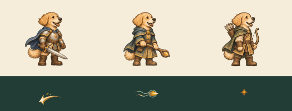
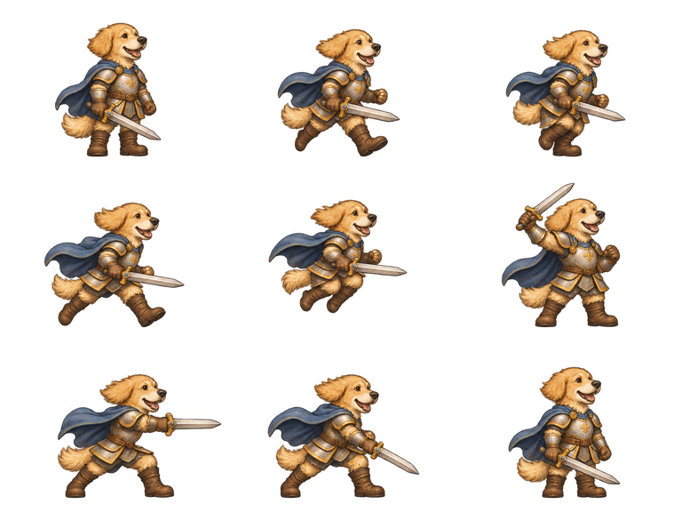
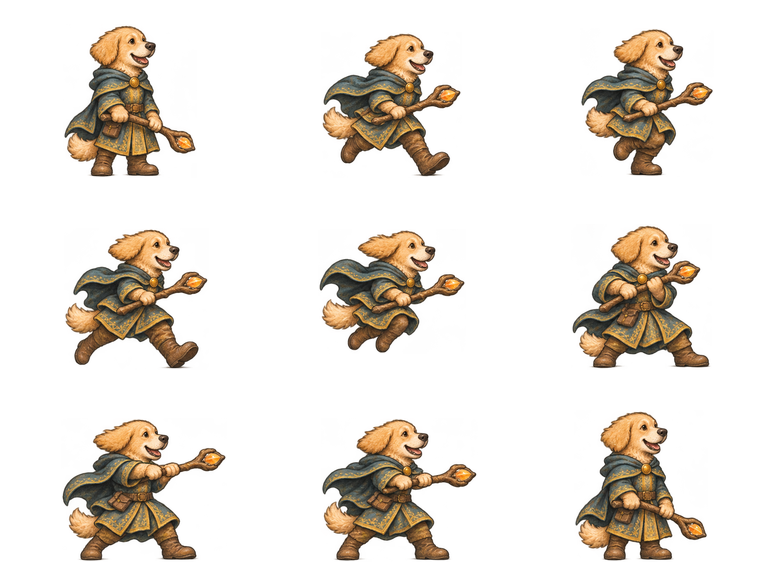
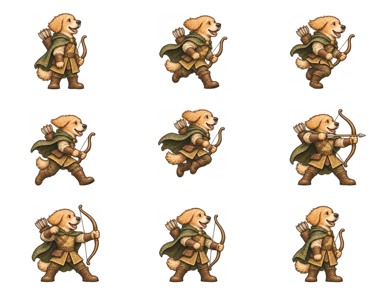

# 金毛騎士、法師與弓箭手



騎士用肩帶動長劍，法師停步把法球送出，弓手拉滿弓弦才放箭。三個職業現在各有四個跑姿與四個攻擊姿勢，還有各自的眨眼、歡呼與蜷睡圖。上圖直接取用遊戲圖集，共 19 格、3.01 秒。每格均已解碼並核對像素。

**[查看五張正式遊戲截圖](https://github.com/QuantumPrediction/DoggyKnight/actions/runs/45067182880/artifacts/14772175663)**　[查看武器、寶物及拾取物](../../../assets/illustrated/motion/objects.png)　[查看劍光、法球及命中逐格](../../../assets/illustrated/motion/effects.png)

| 騎士 | 法師 | 弓箭手 |
| --- | --- | --- |
| [](../../../assets/illustrated/motion/knight.png) | [](../../../assets/illustrated/motion/mage.png) | [](../../../assets/illustrated/motion/archer.png) |

## 場景畫面

在 Linux X11 視窗以 Godot GL Compatibility 和 Mesa llvmpipe 取得根 viewport 實際畫面。場景使用正式角色、敵人與 HUD，按相同條件擺位。工坊可見衛兵長劍、橡木法杖、白蠟木弓，以及圓桌召集鈴、爐火之心和尋路葉盤。另重畫箭矢、經驗晶片及骨頭零食。

| 實際畫面 | 視窗 | 翻滾提示文字完整收在面板內，修正前 → 修正後 |
| --- | --- | --- |
| 弓手遇到追蹤瞄準 | 540×960 | 越界 → 通過 |
| 弓手滿專注、敵方鎖定 | 540×960 | 越界 → 通過 |
| 法師翻滾冷卻 | 540×960 | 通過 → 通過 |
| 騎士小螢幕 | 360×640 | 越界 → 通過 |
| 弓手模擬瀏海畫面 | 390×844 | 越界 → 通過 |

兩版均已套入新角色美術。比較過程只更換翻滾就緒時的一句文字。遊戲內置 StorySans 的中文字集少了「緒」；Ubuntu 改用其他字體補字後，該列從 y=29 延伸到 44，面板內緣止於 40。改為「起步可翻滾」後，五個場景的文字、面板與安全區均通過原有門檻。五張最終 PNG 可由上方截圖連結取得，GitHub 顯示保留至 2027-02-21 04:34（香港）。[十張原始前後對照，至 2026-11-24 04:26（香港）](https://github.com/QuantumPrediction/DoggyKnight/actions/runs/45066383244/artifacts/14771955250) · [逐幅渲染記錄](https://github.com/QuantumPrediction/DoggyKnight/actions/runs/45066383244/job/137343353867) · [全部指紋](checks.json)

## 動作與戰鬥

玩家蓄勢時停在預備圖。真正揮擊或飛行物發射後才顯示出手、延伸和收勢。蓄勢中移動會取消該次攻擊。友方劍光、法球及命中火花各有四格，法球按飛行距離換格。箭尖跟隨正在做碰撞判定的位置。六個遊戲用 PNG 的 SHA-256 與原始製作清單一致。以透明度至少 32/255 量度，57 格各有不同輪廓，最近格邊留白 5 像素。站立及著地時的腳底位於 192 像素高圖格的第 175–177 列，懸空格在第 160 列，從 0 起算。[圖稿提示及指紋](art.json) · [打包工具](../../../tools/pack_hero_motion.py) · [登記的比較](../../requests/20261123-INT-hero-motion.md)

| 職業 | 一週期跑姿 | 一次攻擊的畫格 | 揮擊／發射幀 | 首次扣血幀 | 傷害 |
| --- | --- | --- | ---: | ---: | ---: |
| 騎士 | 2 → 4 | 2 → 4 | 8 | 8 | 10 |
| 法師 | 2 → 4 | 2 → 4 | 16 | 20 | 15 |
| 弓箭手 | 2 → 4 | 2 → 4 | 10 | 12 | 9 |

上述出手、命中及傷害是在原工作環境，用正式角色、相同固定目標及 60 Hz 分別量得。原版八項專項有七項失敗，候選八項全過，完整回歸 967/967。上傳中斷後，六張遊戲用圖已按指紋恢復，公開版保留了同一份逐幀取圖腳本。未裁切的六張母稿與原本 40 格新舊動圖尚未放入分支，製作記錄保存其指紋。上方 19 格是重新以已公開圖集製作的素材示範。[原實作、公開版及示範指紋](checks.json)

公開分支在 Ubuntu 的八項新美術專項均通過。第一次完整回歸有一項提示文字越界。換字後，美術 **8/8**、危險提示 **9/9**、全套 **968/968**，零損壞檔案。本地舊版、本地新版與公開重跑的三職業逐物理幀紀錄共用同一 SHA-256，各 480 筆。[換字前完整輸出](ubuntu-before.log) · [換字後完整輸出](ubuntu-after.log) · [逐幀紀錄](events.tsv) · [GitHub 實際執行](https://github.com/QuantumPrediction/DoggyKnight/actions/runs/45066383244/job/137343353465)

## 兩條弓手路線

全程採固定 cautious、種子 19、同一裝備及守護政策。原工作環境重現歷史兩路各三次倒下。Ubuntu 未重現相同的完整歷史路徑，因此保留嚴格封存比對失敗。再讓 [#25](https://github.com/QuantumPrediction/DoggyKnight/pull/25) 和 [#26](https://github.com/QuantumPrediction/DoggyKnight/pull/26) 在同一台 Ubuntu 各跑兩路，兩份完整戰報和兩份 1-4 入場存檔逐位元組相同。神射兩版均倒下三次退出；遊騎兩版均倒下兩次後完成第一章。神射的 1-4 入場存檔仍吻合歷史。造成跨機差異的原因待查。這些都是工程重播，目標玩家共 0 人。[神射完整戰報](ubuntu-seed19/marksman-report.json) · [遊騎完整戰報](ubuntu-seed19/outrider-report.json) · [存檔與歷史指紋](checks.json) · [原條件失敗](https://github.com/QuantumPrediction/DoggyKnight/actions/runs/45067182880/job/137345848916) · [八檔逐一重驗](https://github.com/QuantumPrediction/DoggyKnight/actions/runs/45067435539/job/137346620683)

```bash
TEST_TIMEOUT=900 bash tools/run_tests.sh storybook_motion
TEST_TIMEOUT=900 bash tools/run_tests.sh warning_readout
TEST_TIMEOUT=900 bash tools/run_tests.sh
profile_dir=$(mktemp -d)
drawing_dir=$(mktemp -d)
XDG_DATA_HOME="$profile_dir" MOTION_CAPTURE_DIR="$drawing_dir" godot --headless --path . \
  --fixed-fps 60 --max-fps 0 --script res://tools/capture_hero_motion.gd
sha256sum "$drawing_dir/events.tsv"
```

逐幀紀錄預期值為 `6eceb2822e1e18d6884e6e8e5bb6789d608e402f80e05e4ffaabd853454d408d`。兩路失敗重播沿用[原指令](../archer-guard-trial/README.md#重跑)。下一輪優先驗證同伴舉盾、格擋與反擊的輪廓，再到真手機檢查 360×640 混戰警示和幀時間。Windows、手機與手把、聆聽、真人無提示試玩、長局與市場驗證仍待完成。暫評維持 6–6.5/10。
