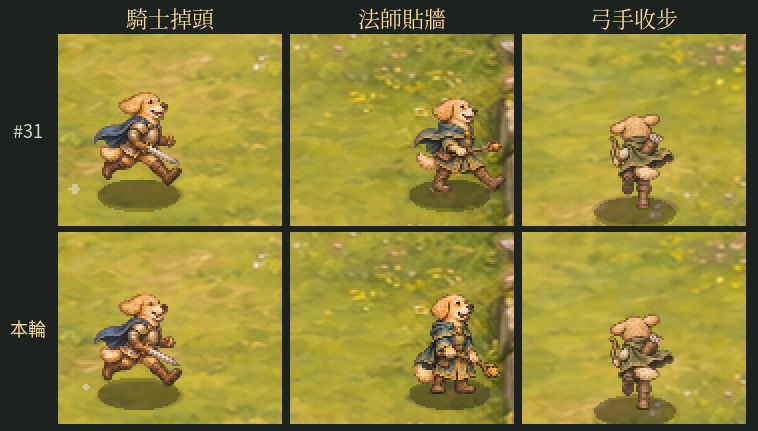

# 黃金騎士的掉頭、貼牆與收步



騎士向右跑再按左時，身體先收住向右的衝力，再轉身。法師頂住場邊時會站穩。弓手向北跑停後仍背對鏡頭，可以看見箭筒與靴跟。上排取自草稿 #31，下排取自本輪。三欄各用同一個固定地面區域，從 360×640 遊戲實拍放大兩倍。每兩個物理幀取一張，依原速循環播放 0.6 秒。[18 對原尺寸遊戲畫面](native-pairs.webp)

## 地面與腳步

同一台 Linux 以 Godot 4.7.2、GL Compatibility、Mesa llvmpipe 渲染，固定鏡頭，每秒 60 個物理幀。三個職業各跑 552 幀，使用正式競技場、角色、碰撞、繪圖及輸入處理。基準為 #31 的 `9b7ed6c449087ae8a89daea997fcecde707b085e`，tree `b96449695d84afda1e34e9ac154381635bdc5fa3`。

| 同一條件 | #31 | 本輪 |
| --- | --- | --- |
| 橫向與縱向掉頭時，身體仍向原方向移動，畫面已反向的幀數 | 每職業每次 3 幀，合計 18 幀 | 0 幀。橫向到 t49、縱向到 t287 改向 |
| 全速 30 幀與半速 30 幀，側跑姿勢切換次數 | 每職業 9、9 | 每職業 9、4 |
| 全速 24 幀與半速 48 幀，行進等距時切換次數 | 每職業 7、15 | 每職業 7、7 |
| t202–255，連推右邊界 54 幀，地面位移為零 | 每職業換 17 次跑姿，鞋底配準點上下相差 0.984 邏輯像素 | 換姿 0 次，配準點高度固定 |
| t216–254，每隔兩幀讀一次角色腳邊 74×78 實際像素 | 每職業 20 張均不同 | 每職業 20 張逐像素相同 |
| 向南、向北停步的六組 | 停定第一幀 t314、t466 均切成側像 | 六組均保留來向。先屈膝落腳，t321、t473 站穩 |

半速用引擎 `Input.action_press` 的類比強度，經玩家實際讀取的 `Input.get_vector()` 得到 0.5。各職業在等距比較中分別移動約 28.0、27.2、31.2 邏輯像素。另用 Godot 螢幕按下、拖曳與放開事件實際送進觸控搖桿。半徑九和十八邏輯像素的拖曳都由現有搖桿回傳全速。這次未使用實體觸控面板或手把。

放開搖桿時放入一隻停止移動的正式稻草人，三職業依次實際出手 2、1、2 次。兩版 131 個攻擊動畫幀均選中同一張畫、同一格和鏡向。隨後移走稻草人，經正式選牌訊號學習翻滾，再次移動。54 個處於翻滾的物理幀，畫格、鏡向、配準點、旋轉與斜切逐值相同。每個鏡頭均保留原始資料。[遊戲物理軌跡](physics.tsv) · [舊版逐幀繪圖](paint-before.tsv) · [本輪逐幀繪圖](paint-after.tsv)

四份物理紀錄（兩版各一次 headless 與 X11）逐位元組相同，SHA-256 為 `d5ad41729ccf3549305c67f6e5782f5732494128b6d57d69390831796427afa9`。同版兩種執行方式的繪圖選擇紀錄也分別完全相同。完整原生畫面每職業保存 t46、238、284、318、375、482 六對，逐幅解碼核對 RGB。配對影像左半為 #31，右半為本輪；先騎士，再法師，再弓手。[量度窗口、程式與原生 PNG 指紋](checks.json) · [三職業 GPT Image 原稿、裝備輪廓與配準](art/README.md) · [標題與舊存檔相容性](identity/README.md)

另以 24 種首章配置、合計 54 次關卡嘗試作戰鬥對照，兩版逐場結算資料吻合。一般出征測種子 31、43；援軍測 7、19。各政策與三倒的場次均保留。[一般出征 12 組](combat/normal-31-43.json) · [援軍 12 組](combat/reinforced-7-19.json)

## 保留的失敗與缺口

- 首個動作候選在翻滾時連舊有傾斜和顛簸一併清除。54 幀的旋轉角度一致，但配準點在 X、Y 最多偏移 2.39、2.83 邏輯像素。最終版在出招期間沿用原有翻滾。[首次差異](failures/roll-first.tsv)
- 玩家被放到合法區域外，首幀校正位置時曾誤判向內走了一步，令邊界測試預期背面卻選中正面。以合法場內起、終點量地面步距後，邊界專項通過。[原始失敗](failures/first-wall-test.txt)
- 第一個取景區的上緣是 y224。弓手背向站定時，t482 在該上緣以上仍有 173 個前後不同的角色像素。已向上擴至 y184，重新渲染兩版。原取景可從完整 t482 按 `(64,224)–(360,364)` 裁回。兩版原裁圖的 RGB SHA-256 分別為 `a6a7e0274076e251a459eb77c9a0f337253b1b4fb051cd999af78546c6f40ff9`、`1d90cc7a1cbb65922fd4816e434f4c9ba1ef9b8ee098ce722fcbb83c2a879834`。
- 固定畫面比較內仍可見微小差異。物理和攻擊姿勢相同時，t375 的角色附近仍有少量像素不同。18 對共 25,836 個相異像素，其中 4 對在角色框以外共差 8 個像素，位於左上角 x0–3、y0，原因未定位。基準 headless 退出列出 8 個 ObjectDB 物件、4 個資源，基準 X11 為 2 個、1 個。兩次最終候選擷取退出時均未列出這類警告，完整回歸及歷史原生崩潰繼續獨立追蹤。[擷取原始紀錄](capture.log)
- 鏡頭只在最後的自動攻擊放入一隻固定目標。混戰中能否看清腳步、方向和警示，以及手機幀時間，仍待真機與首次玩家驗收。下一次無提示試玩請記錄第一個認錯朝向或以為角色仍在移動的時點。目標玩家仍為零，整體暫評維持 6–6.5/10。

## 重跑

先在兩個工作樹各完成 Godot 匯入，再在 X11 以同一份擷取程式執行。將 `before` 與 `after` 指向各次的輸出目錄。將圖像開關設為 0、加上 `--headless` 可重跑相同的物理與繪圖軌跡。

```bash
runner="$PWD/tools/capture_locomotion.gd"
LOCOMOTION_DIR=/tmp/golden-before LOCOMOTION_VIEWPORT=1 godot --path /path/to/control --fixed-fps 60 --resolution 360x640 --display-driver x11 --rendering-method gl_compatibility --audio-driver Dummy --script "$runner"
LOCOMOTION_DIR=/tmp/golden-after LOCOMOTION_VIEWPORT=1 godot --path . --fixed-fps 60 --resolution 360x640 --display-driver x11 --rendering-method gl_compatibility --audio-driver Dummy --script "$runner"
python tools/compare_locomotion.py /tmp/golden-before /tmp/golden-after
```

## 首次開啟網頁

兩個全新 Chromium 設定在載入時均遇到 `Failed to fetch`，其中一次需按重開才進入戰鬥。啟動器現會在該情況自動重開一次。兩個新的設定都在同一錯誤後自動進入標題，期間沒有按鍵；持續失敗會顯示手動重試。兩個第一次失敗的成因仍需跨裝置確認。離線、停用儲存、缺少 WebGL、檔案檢查及遊戲結束均各有測試。封裝核對了六章 36 關、四位同伴與全部三張新圖集。這次瀏覽器測試使用 Linux 軟體 WebGL 2。[瀏覽器啟動紀錄、成品與測試指紋](release-checks.json)
