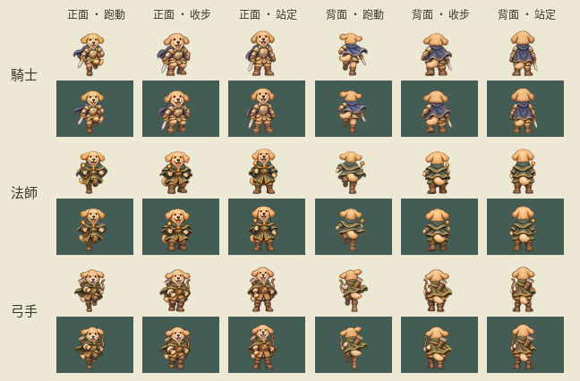

# 收步與站定的角色畫稿



每位角色朝鏡頭或背向鏡頭停下時，先讓一隻靴子承重、膝蓋略彎，再把重心移回兩腳之間。騎士的披風在收步時仍向後揚，法師收住持杖的右臂，弓手左手握弓、右肩背箭筒。騎士與法師始終用右手持武器。正面可見臉、胸章或前襟，背面可見後腦、披風與尾巴。

GPT Image 以 #31 的三張縱跑圖集為角色設定，各繪製一張二行二列的原畫。第一列面向鏡頭，第二列背向鏡頭。左欄收步，右欄站定。三張原始 PNG 的長寬、檔案指紋、實際提示、參照圖及裁切位置均記入製作清單。保存的無損 WebP 與原始 PNG 解碼所得的 RGBA 逐位元組相同。[製作清單](paintings.json) · [原尺寸畫稿](source/)

角色圖格沿用 256×192，髖部對準 x=120，著地基準為 y=176。以透明度至少 32/255 量度，12 幅的靴底在第 175–176 列，離圖格最近的邊仍有 15 像素留白。三份遊戲用 PNG 共 398,819 bytes。用相同畫稿和登記資料再次打包，三份檔案的 SHA-256 均吻合。[逐格尺寸與指紋](checks.json) · [打包工具](../../../../tools/pack_settle_art.py)

上圖將每格縮到約 85×64，對應 360×640 視窗下角色繪圖範圍，分別在淺色和深色襯底檢查。著色輪廓高 48 像素，站定時升至 51 像素，靴底在同一列。跑姿取自 #31 對應方向的第四格。這項圖稿檢查能看清姿勢及裝備方向；混戰中的警示遮擋、手機幀時間與第一次玩的人的判讀，仍須在實際遊戲中觀察。

```bash
python tools/pack_settle_art.py
```
