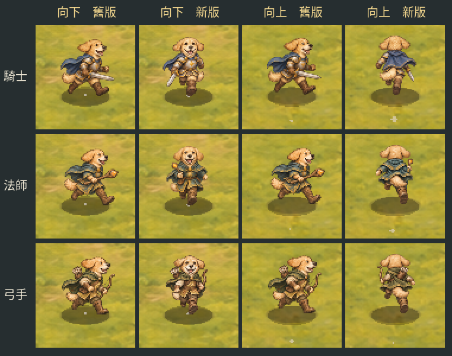

# 縱向跑姿



從角色自己的左右側面跨步切換為正面與背面，可以讓玩家在往上、往下跑時看見金毛的朝向。比較基準為 #30 的 `d2e9b2b3443cbe1ff1ca3d45f597fe3cdcd5ff98`。比較使用正式競技場的玩家、相同輸入和既有動畫時鐘。

## 預先登記的門檻

- 三個職業各有四格面向玩家及四格背向玩家的跑姿。從前方看得到雙眼與胸前服裝，從後方看得到後腦、背部及尾巴。跑動時可辨認同一件劍、法杖或弓與箭袋，武器不因搖桿水平輕微晃動而換手。
- 各圖格沿用 256×192 美術座標及腳底基準 y=176。以 32/255 透明度量度，各格著色輪廓離邊至少 5 px；身體高度與側面跑姿同一量級，前後幀沒有其他圖格的殘影。檢查左右腳是否有交替、各朝向至少四個獨立繪圖。
- 上下切換根據搖桿方向。斜度 `|y| / |x|` 超過 1.6 才進入朝上或朝下的跑姿；已進入的方向保留到斜度降至 1.2。水平、45° 對角、攻擊、停步均使用各自圖格。切換只讀現有播放進度，不重設動畫。
- 以相同的 60 Hz 路徑核對玩家位置、速度及動畫時計。原比較的受擊或通關失敗全部保留。角色朝向是否讓初次玩家更容易判斷，仍需在 360×640 真機混戰中記錄。

## 筆觸與步態

第一批 GPT Image 稿能認出朝向，卻在同一側重複伸腿。第二批補畫另一隻腳朝鏡頭伸出的姿勢，以及膝蓋彎曲、重心下沉的過渡。背面另補了兩次稿，分別處理另一側靴底伸向鏡頭，以及左腳支撐、右腳提起。保留入選的 24 幅原解像裁圖，逐幅記錄來自哪次產圖、原始 PNG 的 SHA-256 與裁切座標。向下時能看見鼻子、胸甲或前襟。向上時可跟著騎士的劍、法師的琥珀杖及弓手的箭筒辨認職業。[原圖裁格](source/) · [製作提示](brush-briefs.json) · [來源與逐格校準](paintings.json)

三張遊戲圖集合共 735,679 bytes。以透明度 32/255 量度，24 幅腳底皆位於 y=175–177，最小留白 14 px。用無損母稿重建，三份遊戲用 PNG 的 SHA-256 全數吻合。正式輸入、上下轉向、搖桿水平微動、跑姿四拍、對角線，以及繪圖邊界的測試全數通過，共 6/6。[打包工具](../../../../tools/pack_vertical_run.py) · [專項輸出](test.log)

## 逐幀比較

每職業從競技場中央開始，以固定 60 Hz 依次向下、向上、左下、右上、停步，每段 36 個物理幀。在同一台 Linux 的 Godot 4.7.2 上，兩版各 540 筆的座標、速度、朝向、動畫、進度與攻擊次數逐位元組相同。兩份 headless 軌跡及兩份 X11／GL Compatibility 軌跡的 SHA-256 都是 `9c2a6637ab7154336f6cb8cd959e5adbf9f480ba2ee867f3d395b3fe63d07c54`。方向在搖桿反向時即轉身，身體仍沿用原來的加減速。[完整軌跡](physics.tsv) · [原生渲染紀錄](render.log)

每職業的正面與背面各取四拍，共 24 對 360×640 原生畫面。上方示範將相同物理幀的角色周邊放大兩倍，共循環顯示四拍。兩版全畫面合計有 40,040 個像素相異，其中 40,010 位於角色及腳步的 84×88 裁圖內。另有 14 對在左上角 `x=0…3、y=0…1` 合計相異 30 個像素，原因未定位。完整的 48 幅以單一無損 WebP 儲存，逐幅解碼後核對 RGB。原始 PNG 和解碼像素的指紋分別保存。[全尺寸配對畫面](native-pairs.webp) · [每幀指紋、裁切區和差異](native-checks.json) · [重建比較](../../../../tools/compare_vertical_run.py)

此取景使用固定競技場，未加入敵人及 HUD 遮擋。實體手機的幀時間、首次玩家能否在混戰中辨認轉身與技能預警，仍待實測。

```bash
bash tools/run_tests.sh vertical_run
VERTICAL_RUN_DIR=/tmp/vertical-new VERTICAL_VIEWPORT=1 godot --path . --fixed-fps 60 --max-fps 0 --script res://tools/capture_vertical_run.gd
# 以同一份 capture_vertical_run.gd 及相同的 Godot 版本對 #30 工作樹執行對照。
python tools/compare_vertical_run.py /tmp/vertical-base /tmp/vertical-new
```
