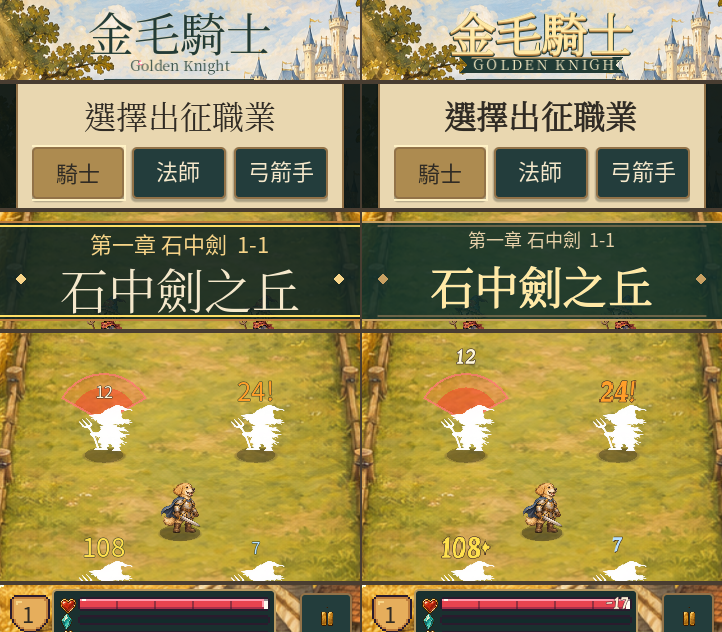

# 封面、關卡題字與命中數字

2026-11-24 香港。基準為 #30 的 `d2e9b2b3443cbe1ff1ca3d45f597fe3cdcd5ff98`。兩版以 Godot 4.7.2、Linux X11、Mesa llvmpipe／GL Compatibility、360×640 及固定 60 Hz 渲染。左圖為基準，右圖為成品。每條橫帶均為原畫面的等比局部，依序是封面、職業、關卡、命中、體力條。



## 字樣與實際數值

- 繪本封面沿用可排版的「金毛騎士」，配金箔邊、墨色窄緞帶及英文副題。職業與關卡使用較有筆重的既有 StorySerif，敘述繼續使用 StorySans。第一章六個關卡名在既有橫幅各保留至少 12 個邏輯像素的左右留白。
- 新字型 `QuillFigures.ttf` 的十個數字、筆尖驚嘆號、四芒星與負號均為手繪輪廓。普通與同伴使用 10 號，暴擊與必殺使用 12 號，後兩者於 130 毫秒內連續收回到原比例。同一套數字也用於連擊。原始輪廓在 [build_combat_figures.py](../../../../tools/build_combat_figures.py)。生成檔 2,040 bytes，重建 SHA-256 為 `7b82fee995f29b171ec53e1813cd28c9f90e916ebb75ea2a65df7f093a8b42eb`。中文字沿用專案內的 Noto CJK 及原授權。
- 普通 12、暴擊 24、必殺 108、同伴 7 都取自正式 `EnemyBase.hit`，兩版傳入值、敵人扣血、飄字值完全相同。第一幀的實際墨跡（寬×高，實體像素）依次由 17×14、36×22、42×21、10×14 變為 20×17、38×23、50×23、11×17。普通與同伴維持 0.7 秒，暴擊與必殺維持 0.8 秒，場上上限仍為 18。
- 玩家受擊以正式事件中護甲與護陣結算後的值在體力條內顯示。試景中輸入 17、實扣 17，體力條顯示「−17」。連續受擊顯示最近一次，每次停留 0.4 秒，再用 0.18 秒淡出。暫停、護陣、必殺、返回、標題圖與開始遊戲的位置均與基準相同。出征列按敵群功能分成普通和援軍兩個按鈕，分別為 72×28、73×28 邏輯像素。360×640 實際字樣見[完整選角畫面](selection.webp)。

## 保留初稿與最後一幀

固定第一章麥田鏡頭，四名普通稻草人受擊，其中一名以正式 `_start_telegraph` 向上預警。時間停在進度 0.72，依序對照沒有警示及字樣、只有警示、警示加字樣的真實輸出。兩張控制圖在兩版間逐位元組相同。以實際 10 段扇形外緣及兩側直線為準，取離廓線 2.2 個實體像素內、確有渲染改變的 600 像素。每幀計算加入普通「12」後改色的外框像素。

| 42 個存活幀 | 外框有覆蓋的幀數 | 單幀最多像素 | 累計像素幀 |
| --- | ---: | ---: | ---: |
| #30 | 32 | 39 | 799 |
| 原地加粗的初稿 | 37 | 56 | 1,615 |
| 按出生時重疊預警數抬字的成品 | 1 | 13 | 13 |

初稿在設計中的粗字與原地警示相撞，已撤回。為重現初稿，在相同源碼的暫存副本將 `CombatFx.damage_number` 的 `number.place_at(at)` 換回 `number.global_position = at`。初稿 `damage_number.gd` SHA-256 為 `105e2739a18f42f16ff5c1c41d2be4ce2ca47967d008d6e08a5c9e59f9d268ad`，`combat_fx.gd` 為 `5983054e8ca04ca6b7b6ecdf43d2d02655ced43c434f5934a04c92b12b183dc9`。

成品在字樣出現時比較原位與頭上最多 16 邏輯像素處的真實攻擊警示數目，較少時才抬字，不會越過戰鬥區上界。這場四個數字中只有普通「12」上移。第 41 幀回落淡出時仍覆蓋外框 13 像素。這是固定鏡頭與固定警示的檢查。移動警示、密集群怪、玩家能否立即分辨與實機持續幀時間仍待試玩。

## 重跑

匯入兩份工程。在各工程自己的目錄用同一份 [capture_playfeel_type.gd](../../../../tools/capture_playfeel_type.gd)，各自設置 `XDG_DATA_HOME` 與 `TYPE_CAPTURE_DIR`，後者分別指向 `captures/base` 和 `captures/candidate`。需要實際 X11 顯示器。

```sh
godot --path . --display-driver x11 --rendering-method gl_compatibility --resolution 360x640 \
  --audio-driver Dummy --fixed-fps 60 --script /path/to/capture_playfeel_type.gd
python tools/measure_playfeel_type.py captures docs/validation/playfeel/lettering
```

[原生數據](native.json) 保留各幀計數、兩次命中畫面墨跡尺寸、完整原圖與裁切序列指紋，亦含撤回的初稿。專項 `test_story_lettering` 五項、既有 `test_hud_polish` 八項、`test_feel` 二十三項在本機通過。原生擷取結束仍有資源退出警告。兩版用 headless 詳細模式亦列出尚在播放的 hurt.wav 與 whoosh.wav，均為本試景觸發的音效。
