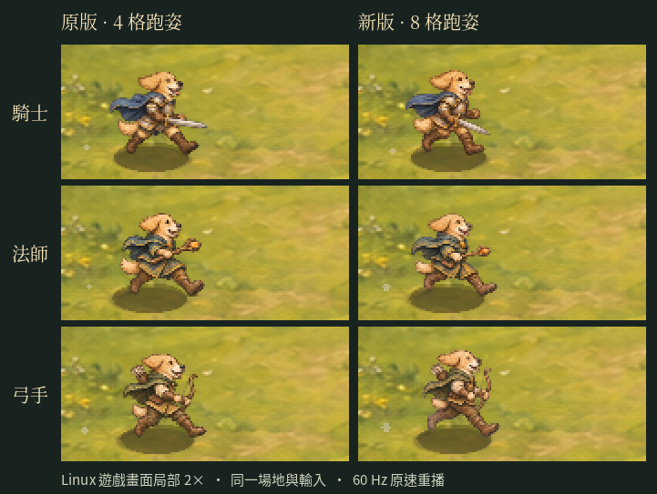

# 三職業側向跑姿



騎士跑步時壓低持劍的肩，法師移步時袍擺和袖子跟著轉動，弓手把弓收在身前，箭袋隨肩膀起伏。GPT Image 依三個既有角色各畫八個姿勢。落腳、屈膝承重、蹬地、騰空各有左右腳兩種，橫向與斜向跑步共用這一組。三張圖集加起來有 24 幅畫。

原來的六格動畫時鐘以 14 格／秒轉完一圈，約 429 毫秒。現在每輪顯示八幅畫，換畫間距由約 107 毫秒縮至 54 毫秒。攻擊和受擊停頓仍用同一個角色時鐘。以圖塊透明度至少 32/255 的像素量度，著地畫的最低點在 y=175–177，兩張騰空畫分別較 y=176 高 8–15 像素。數值來自 256×192 美術圖塊。

## 動畫取樣

左右兩欄分別來自 #30 `d2e9b2b3443cbe1ff1ca3d45f597fe3cdcd5ff98` 與本次候選。Godot 4.7.2、Linux X11、GL Compatibility 與 llvmpipe 在兩次執行中相同。測試直接載入戰鬥場地，三個職業都從相同位置開始，同一個物理 tick 向右輸入。

每個版本保留三職業從 tick 25 至 50 的 78 張連續畫面。示範從每張 360×640 原生畫面裁取 x=50–207、y=265–338，用最近鄰放大兩倍。兩欄同時播放，26 幀共 433 毫秒。片段循環時回到起點。解碼後已逐幀與來源裁圖核對。全幅原始 PNG 指紋與裁切外差異見 [逐幀紀錄](stride-native.json)。裁切外每張最多有 7 個像素不同，位於原畫面最左上角兩行，成因未定位。

同一次執行另從三職業的角色元件擷取持續跑步時選中的圖畫。從 tick 16 到 76，每四個 tick 取一張，裁去透明留白以消除角色在畫布中的位移。三職業各自的 16 個樣本，原版均實際顯示 4 幅獨特圖畫，候選均達 8 幅。逐幀紀錄亦保存這些圖畫的指紋。

同一擷取流程另保留三職業各 160 個物理 tick 的攻擊次數、目標血量和飛行物數量。兩版共用同一份 480 筆結果，與[舊動作封存](../hero-motion/events.tsv)的 SHA-256 一致，為 `6eceb2822e1e18d6884e6e8e5bb6789d608e402f80e05e4ffaabd853454d408d`。動作專項為 11/11。現有證據反映固定輸入在 Linux 的播放，手機幀時間、真人是否看得出腳步和三個職業差異，仍待試玩。

## 重製

`python tools/pack_hero_stride.py` 從[透明原畫](stride-source)重建三個遊戲圖集。[美術紀錄](stride-art.json)保留 GPT Image 提示、原 PNG 與圖集指紋、每張角色的範圍和足底位置。

在已有圖形顯示的終端，以下命令對兩個已匯入 Godot 的工作樹各執行一次。`PROJECT` 指向受測工作樹，`CAPTURE_SCRIPT` 使用本次的 `tools/capture_hero_motion.gd` 絕對路徑，`OUT` 為各版本的獨立輸出位置。

```sh
MOTION_CAPTURE_DIR="$OUT/data" MOTION_VIEWPORT_DIR="$OUT/frames" \
  godot --path "$PROJECT" --fixed-fps 60 --resolution 360x640 \
  --display-driver x11 --rendering-method gl_compatibility --audio-driver Dummy \
  --script "$CAPTURE_SCRIPT"
python tools/pack_stride_preview.py "$BEFORE" "$AFTER" "$PREVIEW_OUT"
```
