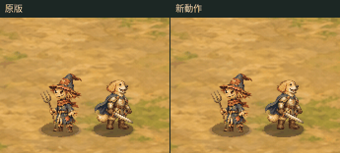

# 稻草人抬叉時

普通稻草人瞄準金毛時，現在會抬起草叉。當地面預警開始閃爍，它把叉舉高。命中判定發生時才前伸，接著降低叉尖，再回到原有站姿。側面、正面及背面各四幅，朝左時沿用側面的鏡像。走路、硬直及精英的外觀沿用原圖。[遊戲圖集](../../../assets/illustrated/motion/scarecrow_swing.png) · [GPT Image 原稿及提示](art.json)



同一次朝右揮擊的兩個版本。各取原生遊戲連續 55 個物理幀的同一區域，放大兩倍、以三分之一速度播放。出手時原有的橙色刀光仍會蓋住部分叉尖。可打開兩張完整 360×640 畫面看角色的實際大小。[正面起手](arena-front-raise.png) · [側面命中](arena-right-release.png) · [十二幅原稿](source.png)

## 固定場景

舊版為 #27 的 `334fd00d8cfcfa4c68ff04d2bcac4f2899216511`。同一個第一章農場、固定的騎士位置及鏡頭，各跑向右、左、鏡頭前和鏡頭後的普通出手，再跑中止及精英。模擬以 60 Hz 運行，騎士在可受擊的位置靜止。這是擺位比較。

| 場景 | 預警／閃爍／判定／收叉 | 活力變化 |
| --- | --- | --- |
| 普通，四方向 | 3／28／34／42 幀，第 44 幀回到休息 | 每次 100 → 90 |
| 第 14 幀暈眩 | 先預警，暈眩後沒有揮出 | 100 → 100 |
| 精英對照 | 3／28／34／42 幀 | 100 → 87 |

新舊版本各 330 筆物理狀態、位置、警示進度、動作及活力逐位元組相同，SHA-256 `22152741c819978b3f959771805d08056a3f9dad136297f8d1f20e011e9f7971`。三項專項涵蓋轉向、閃爍門檻、原動作時鐘、取消、受擊和精英／弓兵。打包時第一次因正面收叉尖端越格而停止，將整組共同腳底線上移四個圖集像素後重做。最初測試場景缺少顯式節點型別，未能啟動，已在正式量測前修正。[逐幀資料](combat.tsv) · [預先登記的門檻](../../requests/20261123-INT-scarecrow-swing-art.md)

## 地面警示還看得到多少

Linux 原生桌面的 Godot 4.7.2（`ed1daf0bf`）使用 X11／GL Compatibility、Mesa 25.0.7 llvmpipe。兩版在相同的 24 個時點拍照，17 對有像素改變，差異全在稻草人原有繪製範圍內。餘下七對包含待機、收招、中斷及精英，整張圖的 RGB 完全相同。基準和候選在警示存在的 11 個時點各多拍一次，只關掉該次繪製的扇形，用於量度。

| 警示像素 | 結果 |
| --- | --- |
| 扇形遠端外弧 | 11 個時點合計原有 1,927 個可見像素樣本，逐點全數保留。每張可見 137–246 個 |
| 扇形其他位置 | 11 幀合計原有 491 個像素消失，另有 674 個露出。正面第 3 幀變化最大，116 個消失、120 個露出 |

各時點、兩版輪廓與繪製範圍均已留存。70 張來源 PNG 的檔案指紋與解碼後 RGB 指紋列在索引中，六組無損 WebP 可還原每一張的完整 RGB。兩張精選 PNG 保留引擎直接寫出的檔案。[全套視覺紀錄](native/) · [影像索引](native/index.json) · [逐幀像素結果](native-checks.json)

## 重驗與下一步

在專案根目錄執行 `python tools/check_scarecrow_swing.py`，以 Pillow 與 NumPy 重新解碼並比較保存的原生畫面。重拍時，兩個版本均放入相同的 `scarecrow_swing_showcase.gd` 及同名場景，先匯入資源，為每次執行提供獨立的 `XDG_DATA_HOME`。分別設定 `SCARECROW_CAPTURE_DIR` 至 `before/on`、`before/off`、`after/on`、`after/off` 的絕對路徑。`off` 設 `SCARECROW_WITHOUT_INK=1`，`on` 設為 0。加入 `SCARECROW_FILM=1` 亦會保留朝右的連續動作。以同一引擎執行下列命令，再把四組資料的共同目錄傳入比較程式。

```sh
godot --fixed-fps 60 --resolution 360x640 --display-driver x11 --rendering-method gl_compatibility --audio-driver Dummy res://tests/integration/scarecrow_swing_showcase.tscn
```

執行檔 SHA-256 為 `8d106cbe6144c2dc7e881d61d2429c1a8a76e6b22ef48bd5e48dcf934953f71e`。本地完整回歸 **975/975**，含本輪專項 **3/3**。完整回歸退出仍列出 27 個 ObjectDB 物件、21 個資源及 RID 警告。乾淨基準首次匯入曾報主題圖片尚未就緒，依專案流程再次匯入後可執行。前輪有堆疊的原生崩潰繼續另案追蹤。GitHub 自動審批拒絕了新增的截圖工作流程，本輪原生畫面全由本地桌面取得。[回歸原始輸出](candidate-tests.log.gz) · [前輪崩潰紀錄](../field-chests/README.md)

接著在真手機以正常速度記錄幀時間，在既有無提示試玩中記下玩家首次把舉叉看成出手或看漏扇形的時點與原話。現有試玩入口限弓手存檔。目標玩家 0 人，擺位比較無法核定真人辨識度；整體暫評 6–6.5/10。[既有試玩入口](../scene-lifetime/archer-trial.md)
